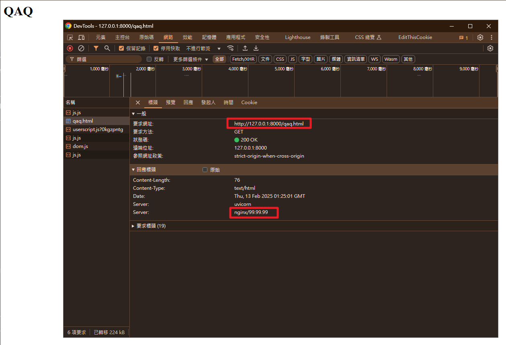

## 說明

- honeypot (蜜罐)，是指用來偵測、抵禦未經授權操作或是Crackers (怪客)攻擊的陷阱，因原理類似誘捕昆蟲的蜜罐因而得名。
- 通常用於「偽裝」成系統弱點/故意設計的Bug，對於拖延 Crackers入侵有一定的效果

----

## 範例

----

### 安裝

```shell
uv add git+https://github.com/utkusen/baitroute.git#subdirectory=py fastapi uvicorn
# or
# pip install git+https://github.com/utkusen/baitroute.git#subdirectory=py fastapi uvicorn

```

- 並且可下載 baitroute[^baitroute] github 主頁面的`rules`資料夾與其內容，內容包含各類 honeypot 的 yaml 檔
- 也可以依照自己的需求增加honeypot path 規則與要回應的偽裝資料

----

### 使用

```python
from fastapi import FastAPI
from baitroute import BaitRoute, Alert
from baitroute.fastapi_integration import register_with_fastapi
import uvicorn


# 增加一個中honeypot的 handle hit
# 依照需要可以將訊息整合至 Sentry Splunk
def handle_bait_hit(alert: Alert):
    print(f"🚨 Bait hit detected!")
    print(f"Path: {alert.path}")
    print(f"Method: {alert.method}")
    print(f"Remote Address: {alert.remote_addr}")
    print(f"Headers: {alert.headers}")
    if alert.body:
        print(f"Body: {alert.body}")
    print("---")


# rules 為資料夾，就是指前面提到的 baitroute github 主頁面的`rules`資料夾
baitroute = BaitRoute("rules")

# 定義命中honeypot規則時要執行的func
baitroute.on_bait_hit(handle_bait_hit)

app = FastAPI()

# self-explanatory
register_with_fastapi(app, baitroute)


@app.get("/")
async def home():
    return {"message": "Welcome to the real application!"}


if __name__ == "__main__":
    uvicorn.run(app, host="0.0.0.0", port=8087)
```

----

- 執行後嘗試`http://127.0.0.1:8087/settings.py` 可以看到網頁回應的假資料

```python
# Django settings for myproject project.
import os
from pathlib import Path

# Build paths inside the project
BASE_DIR = Path(__file__).resolve().parent.parent

# SECURITY WARNING: keep the secret key used in production secret!
SECRET_KEY = 'django-SF@sz789!@#$%^&*()'

# SECURITY WARNING: don't run with debug turned on in production!
DEBUG = True

ALLOWED_HOSTS = []
```

----

- 同時log捕獲下列資訊

```shell
🚨 Bait hit detected!
Path: /settings.py
Method: GET
Remote Address: 127.0.0.1
Headers: {'host': '127.0.0.1:8000', 'connection': 'keep-alive', 'sec-ch-ua': '"Not A(Brand";v="8", "Chromium";v="132", "Google Chrome";v="132"', 'sec-ch-ua-mobile': '?0', 'sec-ch-ua-platform': '"Windows"', 'dnt': '1', 'upgrade-insecure-requests': '1', 'user-agent': 'Mozilla/5.0 (Windows NT 10.0; Win64; x64) AppleWebKit/537.36 (KHTML, like Gecko) Chrome/132.0.0.0 Safari/537.36', 'accept': 'text/html,application/xhtml+xml,application/xml;q=0.9,image/avif,image/webp,image/apng,*/*;q=0.8,application/signed-exchange;v=b3;q=0.7', 'sec-fetch-site': 'none', 'sec-fetch-mode': 'navigate', 'sec-fetch-user': '?1', 'sec-fetch-dest': 'document', 'accept-encoding': 'gzip, deflate, br, zstd', 'accept-language': 'zh-TW,zh;q=0.9,en-US;q=0.8,en;q=0.7', 'cookie': 'csrftoken=T7wJIPNF9WP2MQUcR5McDWRMl1TXYoie', 'sec-gpc': '1'}
```

----

### 自訂規則

----

```yaml
# qaq.yaml
- method: GET
  path: "/qaq.html"
  status: 200
  content-type: text/html
  headers:
    Server: nginx/99.99.99
  body: |
    <HTML>
    <HEAD>
    <TITLE>QAQ</TITLE>
    </HEAD>
    <BODY>
    <h1>QAQ</h1>
    </BODY>
    </HTML>
```

----

- 以下是存取的結果
- 

[^baitroute]: https://github.com/utkusen/baitroute