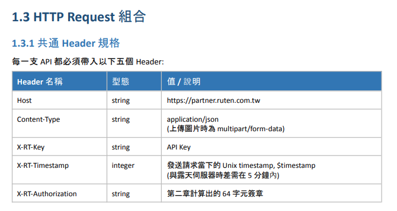

## 說明

- 最近無聊，總之知道露天市集有API可以申請[^官方文件]，所以就弄一組來玩玩了。
- 任何申請或問題，請詳閱官方文件內文。
- API 文件分為下列 PDF
    - 商品檔案
    - 訂單檔案
    - 通知檔案

----

## 注意事項

- PDF 中在「1.2簽章製作」這個章節會卡關一陣子，因為全部 API 不論什麼 Method，每打一次 API 都需要帶上這個"簽章"
- 也因文件中的範例是以 PHP 為例，所以在使用 Python 實踐時，一旦出現錯誤，我就需要先觀察 PHP 中這個函式 return
  了什麼，那Python是否能變出一樣的格式。
- 簽章演算法主要是使用`HMAC-SHA256`[^HMAC]
  ，相較於只使用 SHA256 直接對資料產生雜湊值，透過 HMAC 方法讓金鑰也參與雜湊值的產生。在金鑰只有 Server/Client
  雙方知道的情況下，Cracker 即使拿到資料，也無法產生出一樣的簽章。
- 加上露天 API 會多提供 Salt Key 並要求你加進`HMAC-SHA256`參與簽章的產生，只能說加了鹽就更安全。
- <span style="background-color: black; color: black; user-select: text;">
   但...API Key, Secret Key 與 Salt Key 都是由露天提供，即使加了 Salt Key 增加混淆，且 Secret Key 參與雜奏值運算，但還是無法達成資安理論上的『不可否認性』
  如果你看到了這段話，想了解為何，自己去查或去問AI。
  </span>

----

## 實作

### 1.2 簽章製作

- Python 有內建提供`hmac`與`hashlib`兩個元件可供載入，組合出文件要求的`HMAC-SHA256`，以下是我再進一步整合成 class，更方便我自己使用
- 其中`body`我這樣寫是對的，如果是 GET method，文件要求是 "" 字串，不是`None`

```python
import datetime as dt
import hashlib
import hmac


class RuTenSignature:
    def __init__(self, salt_key: str, secret_key: str):
        self.salt_key = salt_key
        self.secret_key = secret_key

    def get_signature(self, full_url: str, body: str = "", timestamp: float | int | None = None) -> str:
        timestamp = timestamp or int(dt.datetime.now(dt.timezone.utc).timestamp())
        payload = f"{self.salt_key}{full_url}{body}{timestamp}"
        encoded_payload = payload.encode("utf-8")
        return hmac.new(self.secret_key.encode("utf-8"), encoded_payload, hashlib.sha256).hexdigest()
```

### 1.3 HTTP Request 組合

- 這個章節我也看了很久，一開始看到 "每一支 API 都必須帶入以下五個 Header": `Host`, `Content-Type`, `X-RT-Key`,
  `X-RT-Timestamp`, `X-RT-Authorization`，這算好理解。
- 

我一開始是這樣寫:

```python
import httpx2

headers = {
    "Host": "https://partner.ruten.com.tw/",
    "X-RT-Key": "<你的API KEY>",
    "X-RT-Timestamp": "<你當下的 Unix timestamp>",
    "X-RT-Authorization": "<你當下的簽章，記得X-RT-Timestamp 與 計算簽章時的的timestamp要一致>", }
CONTENT_TYPE_JSON = {"Content-Type": "application/json"}
full_url = "https://partner.ruten.com.tw/api/v1/product/store_class/list"
response = httpx2.get(
    full_url,
    headers=headers | CONTENT_TYPE_JSON,
)
print(response.text)
```

然後我就得到了cloudflare 給 400 (??????)，之後我看了很久的`1.3.2 完整請求範例(PHP + cURL)`，當我看到

```php
// php code
$header = [
'Content-Type: application/json',
'X-RT-Key: ' . $apiKey,
'X-RT-Timestamp: ' . $timestamp,
'X-RT-Authorization: ' . $signature,
];
```

呃...我就改成以下這樣，然後就通過了。

```python
import httpx2

headers = {
    "X-RT-Key": "<你的API KEY>",
    "X-RT-Timestamp": "<你當下的 Unix timestamp>",
    "X-RT-Authorization": "<你當下的簽章，記得X-RT-Timestamp 與 計算簽章時的的timestamp要一致>", }
CONTENT_TYPE_JSON = {"Content-Type": "application/json"}
full_url = "https://partner.ruten.com.tw/api/v1/product/store_class/list"
response = httpx2.get(
    full_url,
    headers=headers | CONTENT_TYPE_JSON,
)
print(response.text)
```

## 感想

- 我只能說，看第三方文件串API，熟悉的味道最對味。

[^官方文件]: https://www.ruten.com.tw/help/seller/11335/
[^HMAC]: https://en.wikipedia.org/wiki/HMAC